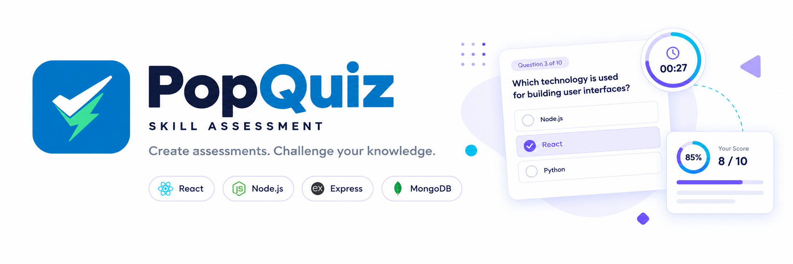

::: {align="center" style="background-color:#FFFFFF"}
    
:::

```{=html}
<hr/>
```
::: {align="center"}
```{=html}
<p>
```
``{=html}
``{=html}
``{=html}
``{=html}
```{=html}
</p>
```
:::

PopQuiz is a full-stack quiz application that allows users to explore
quiz categories, configure assessments, and test their knowledge through
dynamically selected questions. Built with React, Node.js, Express, and
MongoDB, it brings together a complete quiz workflow with session-based
user authentication and shared frontend authentication state.

## 🗺️ Roadmap

### ✅ Completed

-   [x] Design the MongoDB database structure.
-   [x] Build the quiz category browsing page.
-   [x] Integrate the frontend with the backend using Axios.
-   [x] Create APIs for fetching categories and questions.
-   [x] Implement dynamic question selection based on category.
-   [x] Randomly select questions using MongoDB aggregation.
-   [x] Build the assessment configuration form.
-   [x] Implement the quiz interface with a countdown timer.
-   [x] Display assessment results after quiz completion.
-   [x] Implement client-side routing and nested routes for application
    pages.
-   [x] Add user authentication using Passport and session-based
    authentication.
-   [x] Share authentication status, user data, and loading state
    through React Context.
-   [x] Restore authentication state by checking the backend session
    when the app loads.

### 🚧 Upcoming

-   [ ] Complete end-to-end authentication testing, including refresh,
    login, logout, and failed requests.
-   [ ] Add assessment history and performance tracking.
-   [ ] Provide detailed score breakdowns and result analysis.
-   [ ] Improve responsive design across devices.
-   [ ] Expand quiz categories and question management.
-   [ ] Add comprehensive testing and error handling.
-   [ ] Improve form validation, accessibility, and authentication error
    states.

### 🎯 Long-Term Goals

-   [ ] Build a personalized dashboard for users.
-   [ ] Track progress and performance over time.
-   [ ] Enhance the application with additional assessment features.

## 📚 What I Learned

Building PopQuiz helped me move beyond isolated features and understand
how a full-stack application works from frontend to backend.

-   **React Development** --- Building reusable components, managing
    state, handling user interactions, and working with forms.
-   **Routing & Layouts** --- Using React Router, nested routes, and
    shared layouts to organize application pages.
-   **Reusable Logic** --- Learning how custom hooks can encapsulate and
    reuse stateful logic.
-   **Authentication State** --- Using React Context to share user and
    authentication state, and understanding loading states and state
    updates.
-   **Frontend--Backend Integration** --- Connecting React with an
    Express backend using Axios and handling API requests and responses.
-   **REST APIs** --- Working with GET and POST requests, query
    parameters, request bodies, and dynamic data flow.
-   **MongoDB & Mongoose** --- Designing database schemas, working with
    referenced documents, and retrieving structured data.
-   **MongoDB Aggregation** --- Using `$lookup` to join related
    collections, `$match` to filter questions by category, and `$sample`
    to select random questions.
-   **Dynamic Quiz Logic** --- Fetching questions according to the
    selected category and question count.
-   **Assessment Workflow** --- Connecting assessment configuration,
    question delivery, countdown timer, and result generation into one
    flow.
-   **State & Data Management** --- Passing assessment data between
    pages, updating shared state, and keeping the frontend synchronized
    with backend responses.
-   **Effect Lifecycle** --- Working with `useEffect`, dependency
    arrays, component lifecycle behavior, and cleanup.
-   **Authentication Flow** --- Connecting Passport sessions on the
    backend with frontend authentication checks and login/logout state
    updates.
-   **Debugging & Problem-Solving** --- Identifying API, query, state,
    and data-flow issues by inspecting actual values, testing edge
    cases, and improving backend response structures.
-   **Full-Stack Application Architecture** --- Understanding how the
    frontend, backend, APIs, and database work together to deliver a
    complete application.

### 💡 Key Takeaway

I believe the best way to learn is by building, experimenting, and
solving problems along the way. Every challenge in PopQuiz pushed me to
explore new concepts, think independently, and turn unfamiliar problems
into learning opportunities. I'm confident in my ability to learn new
technologies, adapt to challenges, and keep improving with every project
I build.

## 🚀 Run Locally

### 1. Clone the Repository

``` bash
git clone <your-repository-url>
cd PopQuiz
```

### 2. Install Dependencies

**Frontend**

``` bash
cd frontend
npm install
```

**Backend**

``` bash
cd ../backend
npm install
```

### 3. Configure Environment Variables

Create a `.env` file inside the `backend` directory.

``` env
MONGO_URI=your_mongodb_connection_string
PORT=5000
```

### 4. Start the Application

**Backend**

``` bash
cd backend
node app.js
```

**Frontend**

Open a new terminal in the project directory.

``` bash
cd frontend
npm run dev
```

### 5. Open PopQuiz

Visit the local URL displayed in your frontend terminal to use the
application.

## 👨‍💻 About Me

Hi, I'm Priyanshu Ben, a developer passionate about building web
applications and solving problems through code.

-   🌱 Currently learning Full Stack Development.
-   💻 Building projects using React, Node.js, Express, and MongoDB.
-   🚀 Working on projects like PopQuiz to strengthen my development
    skills.
-   🎯 Looking for a Full Stack Developer Internship.
-   🌍 Interested in open source and aiming to contribute to GSoC 2027.
-   📚 I believe the best way to learn is by building real-world
    projects.

## Authors

[@priyanshuben](https://github.com/priyanshu-ben-projects/PopQuiz)

[](www.linkedin.com/in/priyanshu-ben)
